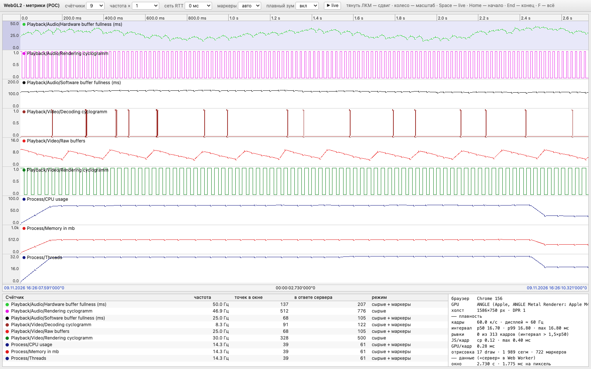

# WebGL2 metrics POC: как запустить

Прототип вьюера метрик для SelengeMuren (p8). Он проверяет, насколько плавно браузер двигает и масштабирует
графики, если клиент получает от сервера только окно данных. Сделан по скриншоту старого Telemetry‑вьюера:
панели счётчиков одна под другой, ось времени сверху, метки времени снизу, маркеры на сырых точках.
Данные синтетические: запись началась за час до открытия страницы.



## Что нужно

- Python 3, только стандартная библиотека: раздаёт страницу.
- Браузер с WebGL2: Chrome, Edge, Safari или Firefox.
- Для автопроверки: Google Chrome и `playwright-cli` (`npm install -g @playwright/cli`).

## Запуск

Из корня репозитория:

```bash
python3 tests/ui/scripts/serve.py --open
```

Сервер слушает `http://127.0.0.1:8765/`. Открыть в нужном браузере:

```bash
open -a "Google Chrome" http://127.0.0.1:8765/
```

```bash
open -a Safari http://127.0.0.1:8765/
```

Открыть `poc/index.html` двойным кликом не получится: страница запускает Web Worker, а с `file://` браузеры
его не загружают. Чтобы зайти с другой машины в сети, запустите сервер с `--host 0.0.0.0`; порт меняется
через `--port`.

## Управление

| Действие | Что делает |
|---|---|
| Тянуть левой кнопкой | сдвиг, график идёт за мышью 1:1 |
| Колесо, щипок на тачпаде | масштаб вокруг курсора |
| Горизонтальный свайп на тачпаде | сдвиг |
| `Space`, кнопка `live` | live: правый край идёт за реальным временем с задержкой 100 мс |
| `Home` | начало записи, окно 2,73 с |
| `End` | конец записи |
| `F` | вся запись, около часа |
| `+` / `−` | масштаб вокруг центра |
| `←` / `→` | сдвиг на 10 % окна, с `Shift` на 50 % |

Хоткеи привязаны к `event.code` и работают в любой раскладке. Сочетания с `Ctrl`, `Cmd` и `Alt` страница
не перехватывает.

Панель инструментов:
- **счётчики** — 9, 18, 36 или 72 (копии девяти базовых);
- **частота ×** — множитель частоты сэмплов: при ×10 000 счётчики идут на сотнях кГц;
- **сеть RTT** — задержка ответа «сервера», 0–100 мс;
- **маркеры** — квадраты на сырых точках, когда точки стоят дальше 5 px друг от друга;
- **плавный зум** — анимация масштаба (τ = 45 мс) или мгновенный шаг.

## Что показывает панель внизу

Таблица счётчиков:
- **частота** — частота сэмплов с учётом множителя;
- **точек в окне** — сколько сырых точек попадает в видимое окно;
- **в ответе сервера** — сколько точек сервер прислал для счётчика (окно с запасом ±50 %);
- **режим** — `сырые` (с маркерами или без) или `M4`.

Справа:
- **кадры, дисплей ≈ Гц** — частота кадров и оценка частоты экрана по медиане интервалов;
- **интервал p50 / p99 / max** и **рывки** — кадры длиннее 1,5 × медианы, за последние 600 кадров;
- **JS/кадр** — время кода страницы в кадре;
- **GPU/кадр** — время GPU по `EXT_disjoint_timer_query_webgl2`; Safari и Firefox его обычно не дают;
- **отрисовка** — draw calls, сегменты линий и маркеры за кадр;
- **ответ** — размер последнего ответа сервера, число точек и время генерации в воркере;
- **запросы** — запросов и байт в секунду;
- **без данных у края** — кадры, где часть окна ещё не покрыта ответом, например при быстром зуме.

## Как проверить 120 Гц

- Chrome и Edge на ProMotion‑экране рисуют с частотой экрана.
- Safari по умолчанию ограничивает страницы 60 Гц. Чтобы снять ограничение: Settings → Advanced → Show features
  for web developers, затем в Feature Flags снять «Prefer Page Rendering Updates near 60fps» и перезапустить
  Safari.
- Headless Chrome в автопроверке всегда рисует 60 Гц.

## Автопроверка

При запущенном `serve.py`:

```bash
tests/ui/scripts/smoke_check.sh
```

Скрипт открывает страницу в headless Chrome, тянет график, отдаляет до всей записи, включает стресс
(72 счётчика × 10 000) и приближает до микросекунд. Он печатает строки HUD и сохраняет скриншоты во
временную папку, путь печатается в конце. URL и папку можно передать аргументами:
`smoke_check.sh [url] [out_dir]`.

## Файлы

| Файл | Что внутри |
|---|---|
| `poc/index.html` | разметка и стили |
| `poc/app.js` | клиент: WebGL2, ввод, HUD; данные только запрашивает и рисует |
| `poc/server_sim.js` | «сервер» в Web Worker: на запрос окна отдаёт сырые точки или M4 |
| `poc/signals.js` | синтетические счётчики, общие для клиента и сервера |
| `scripts/serve.py` | статический HTTP‑сервер для `poc/` |
| `scripts/smoke_check.sh` | headless‑проверка через `playwright-cli` |
| `doc/conclusions.md` | выводы обсуждения и замеры |
| `doc/memory.md` | заметки ассистента между сессиями |
| `doc/img/` | скриншоты из автопроверки |

## Протокол «клиент — сервер» в POC

Это протокол POC. Целевая модель другая: масштаб дискретный (X пикселей — одна единица времени), и сервер шлёт
одну агрегированную точку на ячейку, см. [conclusions.md](conclusions.md).

Запрос (`postMessage` в воркер):

```js
{ id, gen, epochMs, lo, hi, nsPerPx, n, mult, rtt }   // lo, hi — нс от начала записи
```

Ответ:

```js
{ id, gen, lo, hi, genNow, nsPerPx,
  offsets: Uint32Array(n), counts: Uint32Array(n),     // где лежат точки каждого счётчика в buf
  raw: Uint8Array(n),                                   // 1 — сырые точки, 0 — M4
  buf: ArrayBuffer }                                    // пары Float32: x — нс от lo, значение
```

- Сырые точки сервер шлёт, пока их не больше двух на пиксель. Дальше он шлёт M4: для каждой колонки — первую,
  минимальную, максимальную и последнюю точку. Ширина колонки — степень двойки в нс, не больше пикселя.
- В полёте не больше одного запроса, побеждает последний вид. Ответ покрывает окно с запасом ±50 %. Новый запрос
  уходит, когда до края запаса остаётся 20 % окна или масштаб изменился больше чем в 1,5 раза.
- На GPU координата x — смещение от `lo` во float32, поэтому её точность при любом зуме намного меньше пикселя.
- Для M4 POC читает только 8 точек из колонки; настоящий сервер считает по всем.
