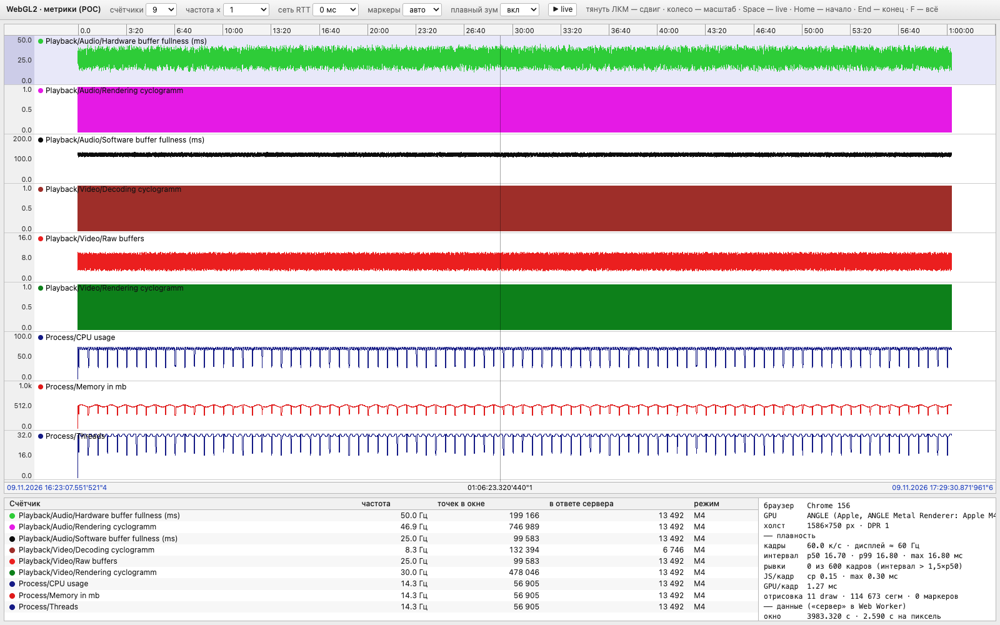

# UI‑эксперимент: выводы

Итоги обсуждения «Архитектура сервера» от 2026‑11‑09 и замеры WebGL2‑прототипа из `tests/ui/poc`.
Как запускать — в [README.md](README.md).

## Принятые решения

- **Клиент — web.** UI раздаёт сам Go‑сервер, поэтому версии клиента и сервера не расходятся. Для сравнения:
  вьюер Tracy должен быть ровно той же версии, что и клиент (корневой `README.md`).
- **Клиент не берёт все данные.** Он отправляет запрос (время, масштаб, длительность) и получает ограниченное
  окно, обычно десятки–сотни КБ.
- **Обработка — на сервере:** фильтрация, агрегация для показа, поиск, DSL. Клиент только управляет и
  отображает. MCP работает через тот же серверный движок.
- **Вид для показа.** Масштаб дискретный: каждые X пикселей (например, 16) — одна единица времени. На запрос
  окна сервер берёт все сырые точки каждого видимого счётчика в каждой ячейке, считает одно значение (среднее,
  p99 или другое, в зависимости от вида отображения) и шлёт только эти точки. Пример: окно 10 мс, X = 16 px,
  ширина 160 px — 10 точек, от 0 до 9 мс. Хранение при этом не агрегируется: сырые данные остаются, значения
  пересчитываются из них на каждый запрос, поэтому зум до наносекунд работает.
- **Размер ответа — всегда килобайты:** счётчики × ячейки × ~4 Б, время точки задаёт номер ячейки. При ширине
  1538 px и X = 16 px это 96 ячеек: ~3,5 КБ на 9 счётчиков и ~28 КБ на 72.
- **Развёртывание — один бинарник, два профиля.** У разработчика сервер слушает 127.0.0.1 без авторизации и
  открывает файлы по пути. Командный сервер работает по TLS, удалять потоки и менять настройки можно только с
  правами, файлы приходят загрузкой.
- **Сначала один сервер, кластер потом.** Поток — единица работы и шардирования: приём, слияние, хранение и
  индекс у каждого потока свои. Общая работа нескольких потоков — только виды и запросы. В кластере это сбор с
  узлов данных размером с экран, распределённой сортировки нет.
- **Приём важнее зрителей.** Если запрос затормозит приём, обратное давление дойдёт до приложений: писатель
  логов ждёт свободный буфер, а не выбрасывает запись (`engine/p8_log.cpp:436`). Приём и запросы — раздельные
  ресурсы, у запросов есть лимиты.

## Что первым упрётся у одного сервера

По замерам слияния на `lau/sorting-testing` (`tests/sorting/doc/results.md`) одна горутина сливает 156–236 М
логов/с и 263–432 М метрик/с. 10 GbE несёт ~22 М логов/с или ~52 М метрик/с, то есть слияние занимает
0,1–0,2 ядра на каждые 10 GbE приёма и 1–2 ядра на 100 GbE. Хранение и индекс ещё не мерили.

Раньше процессора кончится место на диске: 10 GbE без перерыва — 4,5 ТБ сырых данных в час. Вопрос лимитов
хранения (автоматически или только ручным удалением потоков) открыт.

## Что модель ячеек значит для сервера

- Вся тяжесть — в пересчёте. Окно 10 с при 500 кГц — это 5 млн сырых точек на счётчик, у 72 счётчиков 360 млн
  на один запрос. Для длинных окон рядом с сырыми данными нужны сводки по блокам времени; сырые данные при этом
  остаются.
- avg, min, max и count складываются из сводок блоков точно, p99 — нет. Для p99 нужен либо проход по сырым
  точкам, либо mergeable sketch (DDSketch, t‑digest) с известной погрешностью.
- Среднее по ячейке съедает короткие пики: импульс 1,4 мс в ячейке 10 мс даёт 0,14. Для циклограмм и всплесков
  вид отображения — max или p99.
- Плавность от этого не страдает. Сетка ячеек привязана ко времени, при перетаскивании она сдвигается на доли
  ячейки, а клиент докачивает только новые ячейки у краёв.

## Ограничения браузеров (проверено в ноябре 2026)

| Ограничение | Кого касается | Обход |
|---|---|---|
| Safari по умолчанию рисует страницы на 60 Гц на ProMotion‑экранах | Safari и WKWebView (Tauri на Mac) | Chrome/Edge, Electron или снять флаг |
| `Ctrl/Cmd+W/T/N`, их `Shift`‑варианты, `Ctrl+Tab`, `Cmd+Q` забирает браузер | обычная вкладка | установить UI как приложение (PWA) в Chrome/Edge или полноэкранный режим |
| WebGPU и SharedArrayBuffer — только в secure context (HTTPS или localhost) | UI по `http://<IP в LAN>` | HTTPS; без него работают WebGL2 и WebSocket |
| wasm32 ограничен 4 ГБ, Memory64 в Safari нет | только если держать данные в клиенте | данные на сервере |
| WebGPU включён по умолчанию не везде на Linux | — | базовый уровень — WebGL2 |

Прецеденты «данные на сервере»: Perfetto UI добавил нативный `trace_processor`, когда упёрся в память вкладки,
а Rerun ради того же стал подгружать данные с сервера. У Tracy есть web‑демо на WASM.

## Вкладки, хоткеи, протоколы

- **Синхронизация вкладок.** Надёжнее всего одна вкладка с панелями: одно состояние времени и один цикл
  отрисовки. Между вкладками — `BroadcastChannel` (Safari с 15.4): по нему идут изменения состояния
  `{ t_left_ns, duration_ns, live, cursor_ns }`, а не кадры. Общий хаб и одно соединение на все вкладки даёт
  `SharedWorker` (Safari с 16). Скрытая вкладка не рисует, браузер ставит `requestAnimationFrame` на паузу.
- **Хоткеи.** Свободны одиночные клавиши, стрелки, `+/−`, `Home/End`, `/` и многие `Ctrl/Cmd`‑сочетания
  (`F`, `K`, `S`, `Z`). Буквенные хоткеи нужно привязывать к `event.code`, иначе на ЙЦУКЕН они не сработают.
- **Протоколы.** Управление — HTTP и JSON. Данные — один WebSocket на вкладку: запросы окон, отмена устаревших
  запросов, live‑подписка. WebTransport есть во всех браузерах с Safari 26.4, на него можно перейти позже.
  SSE не подходит, он передаёт только текст; чистого TCP в браузере нет.

## Замеры прототипа

POC сделан иначе, чем целевая модель. Масштаб у него непрерывный, а сервер шлёт сырые точки, пока их не больше
двух на пиксель, а дальше M4: первую, минимальную, максимальную и последнюю точку каждой колонки пикселя,
1–2 колонки на пиксель, с запасом ±50 % по краям окна. Линия при этом та же, что из сырых данных (Jugel et al.,
PVLDB 2014), но ответ больше. Последний столбец — расчёт для целевой модели: 96 ячеек, без запаса.

Условия: headless Chrome 156, Apple M4 Max, DPR 1, холст 1586×750; headless рисует 60 Гц.

| Сценарий | JS на кадр | GPU на кадр | Рывки | Ответ POC | Целевая модель, расчёт |
|---|---|---|---|---|---|
| 9 счётчиков, окно 2,73 с, сырые точки и маркеры | 0,13 мс | 0,25–0,37 мс | 0 из 600 кадров | 16–20 КБ | ≈3,5 КБ |
| Вся запись (~1 ч), всё в M4, 115 тыс. сегментов | 0,14 мс | 1,06 мс | 0 | 918 КБ | ≈3,5 КБ |
| 72 счётчика × 500 кГц, 1,29 млн сегментов | 0,15 мс | 3,1–5,0 мс | 0 | 10,3 МБ | ≈28 КБ |
| Зум до 226 мкс (147 нс на пиксель) при ×10 000 | 0,16 мс | 1,0 мс | 0 | 24 КБ | ≈3,5 КБ |

- В рабочих сценариях кадр стоит десятые доли миллисекунды JS и до миллисекунды GPU. До бюджета 120 Гц
  (8,3 мс) далеко.
- Сдвиг не ждёт сервер: пока ответ с запасом покрывает окно, график сдвигается на GPU без новых запросов.
- В POC стоимость кадра растёт с числом сегментов, то есть со счётчиками × пикселями, а не с частотой данных.
  В целевой модели сегментов столько же, сколько ячеек: 96 на счётчик вместо тысяч.
- Ответ POC растёт так же, до 10 МБ на 72 счётчика, потому что POC шлёт M4 на каждую колонку пикселя с запасом.
  Это свойство POC, а не архитектуры: в целевой модели ответ остаётся в килобайтах.
- Кадры «без данных у края» бывают только при быстром зуме, когда анимация обгоняет ответы, потому что в полёте
  один запрос.

## Что не проверено

- Целевая модель с ячейками X px и агрегацией на сервере: POC её не реализует.
- 120 Гц на ProMotion, Safari, Firefox, DPR 2, GPU на Windows и Linux.
- Настоящий Go‑сервер, сеть, протокол поверх WebSocket, live при реальном приёме.
- Логи и трейсы: прототип рисует только метрики.
- Подписи рисует Canvas2D; при большом числе подписей это может стать заметным.

## Источники

- [WebGPU is now supported in major browsers (web.dev)](https://web.dev/blog/webgpu-supported-major-browsers), [gpuweb implementation status](https://github.com/gpuweb/gpuweb/wiki/implementation-status)
- [WebKit bug 173434: 120 Hz rAF](https://bugs.webkit.org/show_bug.cgi?id=173434), [WebKit bug 272226: флаг 60 fps и PWA](https://bugs.webkit.org/show_bug.cgi?id=272226), [MacRumors: 120 Гц в Safari](https://www.macrumors.com/how-to/enable-smoother-120hz-browsing-in-safari/)
- [Chromium: browser_command_controller.cc](https://raw.githubusercontent.com/chromium/chromium/main/chrome/browser/ui/browser_command_controller.cc), [Mozilla bug 1074971](https://www.bugzilla.mozilla.org/show_bug.cgi?id=1074971), [Keyboard Lock API](https://developer.chrome.com/docs/capabilities/web-apis/keyboard-lock)
- [MDN: WebGPU API](https://developer.mozilla.org/en-US/docs/Web/API/WebGPU_API), [MDN: SharedArrayBuffer](https://developer.mozilla.org/en-US/docs/Web/JavaScript/Reference/Global_Objects/SharedArrayBuffer), [MDN: Secure contexts](https://developer.mozilla.org/en-US/docs/Web/Security/Defenses/Secure_Contexts)
- [SpiderMonkey: Memory64](https://spidermonkey.dev/blog/2025/01/15/is-memory64-actually-worth-using.html), [WebKit bug 300538: Memory64](https://bugs.webkit.org/show_bug.cgi?id=300538)
- [WebTransport is now Baseline](https://webrtc.ventures/2026/04/webtransport-is-now-baseline-what-it-means-for-real-time-media/), [Chrome: WebSocketStream](https://developer.chrome.com/docs/capabilities/web-apis/websocketstream)
- [caniuse: BroadcastChannel](https://caniuse.com/broadcastchannel), [web-features: Shared workers](https://web-platform-dx.github.io/web-features-explorer/features/shared-workers/), [MDN: requestAnimationFrame](https://developer.mozilla.org/en-US/docs/Web/API/Window/requestAnimationFrame)
- [Perfetto: large traces](https://perfetto.dev/docs/visualization/large-traces), [Rerun ARCHITECTURE.md](https://github.com/rerun-io/rerun/blob/main/ARCHITECTURE.md), [Tracy README](https://cdn.jsdelivr.net/gh/wolfpld/tracy@master/README.md)
- [M4: A Visualization-Oriented Time Series Data Aggregation (PVLDB 2014)](https://datavis.cs.columbia.edu/files/papers/m4.pdf)
- [DDSketch: A Fast and Fully-Mergeable Quantile Sketch with Relative-Error Guarantees (PVLDB 2019)](https://www.vldb.org/pvldb/vol12/p2195-masson.pdf)
